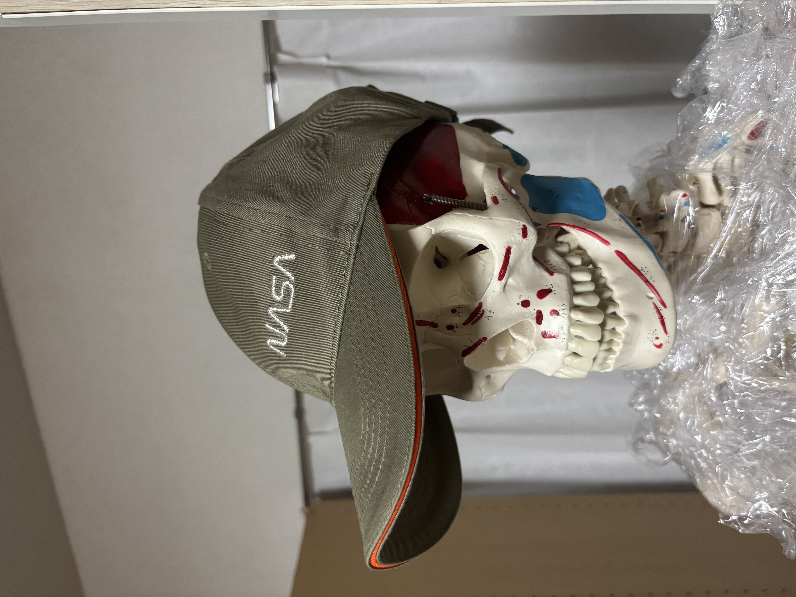

> 2024年8月の出来事を、2026年10月に振り返って書いています。

## 見出しと段落

`## ` で始めると大見出し、`### ` で小見出しになります。空行で段落が分かれます。

### 小見出しの例

**太字** や *斜体*、[リンク](https://astro.build/) も使えます。

## 表

| 材料 | バンドギャップ（eV, 300K） |
| --- | --- |
| Si | 1.12 |
| GaAs | 1.42 |
| 4H-SiC | 3.26 |
| GaN | 3.4 |

## コード

```python
# 熱電圧 kT/q を求める
k = 1.380649e-23   # ボルツマン定数 [J/K]
q = 1.602176634e-19  # 電気素量 [C]
T = 300
print(f"kT/q = {k * T / q * 1000:.2f} mV")
```

## 引用

> 引用したい文章は、行頭に `>` を付けます。
## 修論

今現在大学院2年ですが、実験や学会発表など一段落つきました。修論を書き始めています。

### どんな研究？

どんな研究科は詳しくは書きませんが、簡単に言えば炭素材料の応用物理です。


## Claudがエグい

今修論をざっと書いて、というよりClaudに生成させてます。いまもうAIに任せて序論以外ほぼ完成しかけているのですが、ほとんどAIに書かせて俺は何もしてません。
まじで40000字くらいもう生成されてる状況です。

はたしてこのままでよいのだろうか、という不安感も持ちつつ、たぶんどうせこのままAIに全任せして修士を終了するんでしょうな。
社会人になったら苦労するんだろうなー。。。でも早く社会人になりたい。

## お気に入りの画像

おうちに骸骨模型がありまして、2か月前くらいに買った帽子かぶせて写真撮りました。


## 終わりに

とりあえず簡単な報告や心の丈を書いてみました。
これからもモチベとか忘れたりしてなければ続けてみたいと思います。